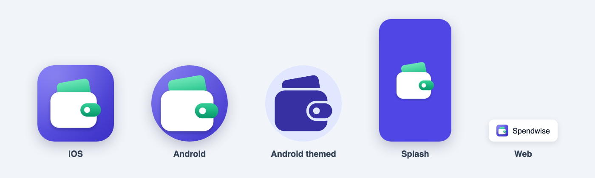
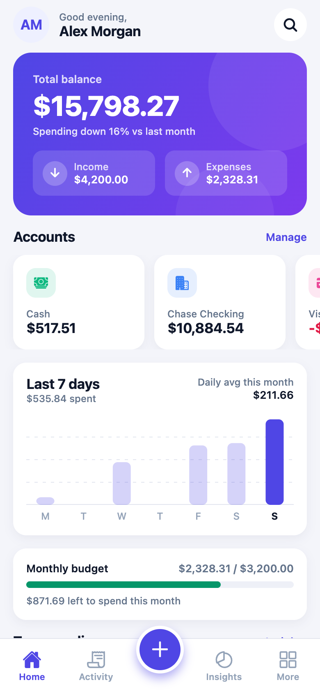
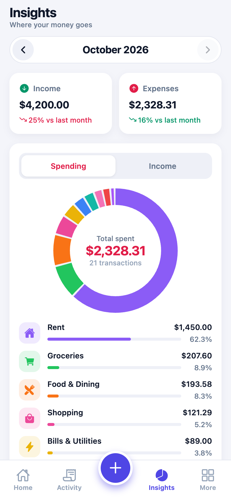
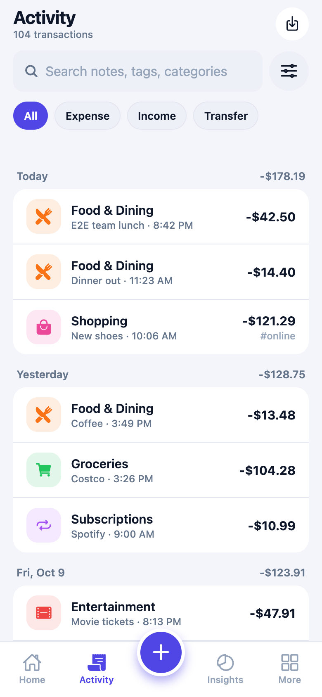
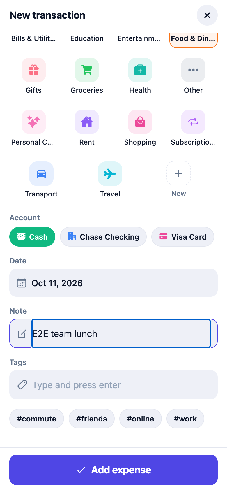
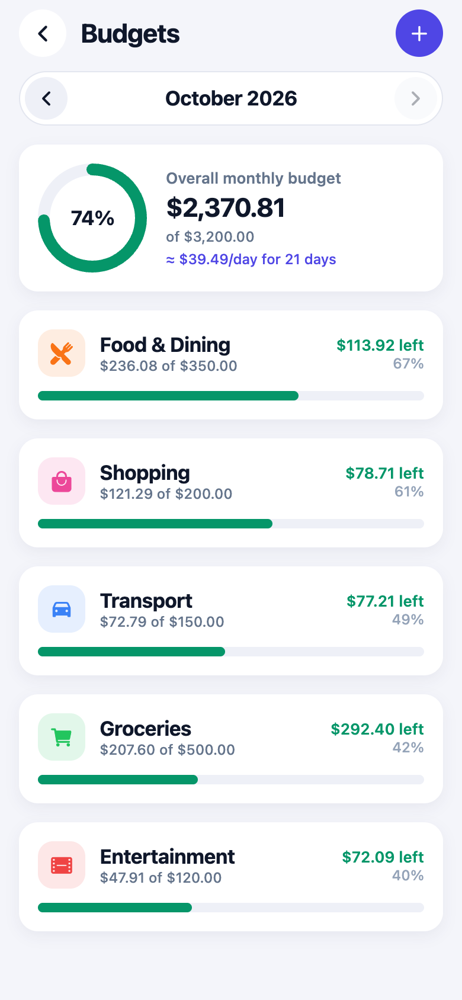
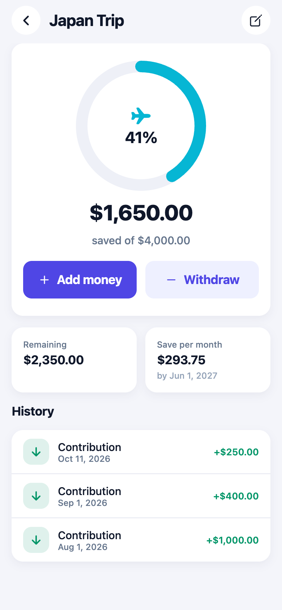
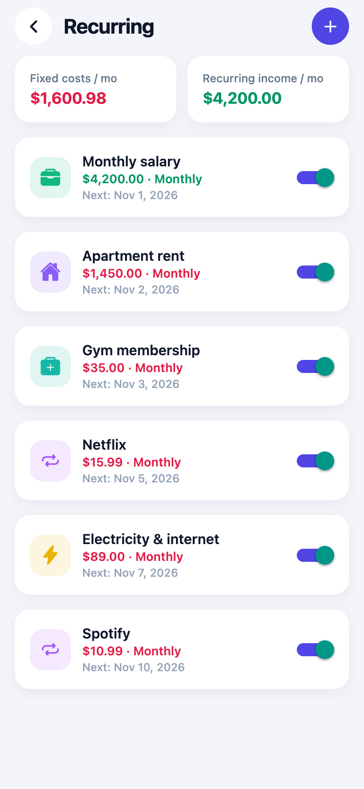
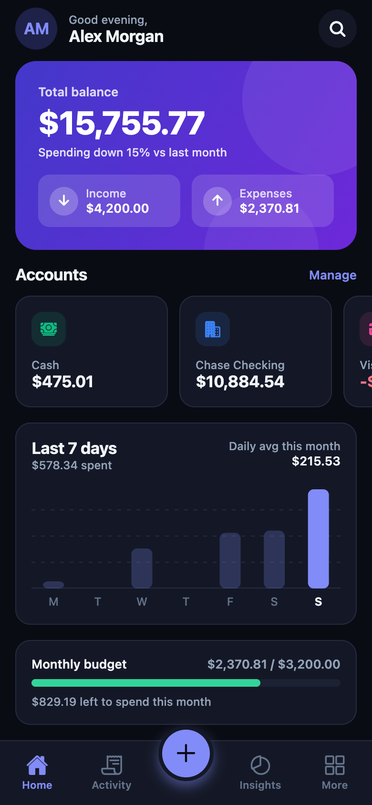

# Spendwise: Expense Tracker App

The **React Native (Expo SDK 57)** client for Spendwise, a personal finance app. It runs on iOS, Android and web.
It needs the API from **[expense-tracker-backend](https://github.com/mhdnihaal1/expense-tracker-backend)**.

**Live web app:** https://expense-tracker-frontend-beryl-psi.vercel.app (hosted on Vercel) · **API:** https://expense-tracker-backend.onrender.com/api (hosted on Render)



| Dashboard | Insights | Activity | Add transaction |
|---|---|---|---|
|  |  |  |  |

| Budgets | Savings goal | Recurring | Dark mode |
|---|---|---|---|
|  |  |  |  |

## Features

- **Accounts & wallets:** cash, bank, cards, e-wallets and savings, with live balances, net worth, assets and liabilities, and archiving.
- **Transactions:** expense, income, and transfers between accounts. Each has notes, tags, a date picker and haptic feedback.
- **Search & filters:** full-text search across notes, tags and category names; filter by type, month, account, category and amount range. The list scrolls infinitely, grouped by day with daily totals.
- **Categories:** 19 defaults plus your own, with 56 icons and 16 colors.
- **Budgets:** an overall budget and per-category monthly limits, with progress rings, a custom alert threshold, dashboard warnings and a safe-to-spend-per-day figure.
- **Savings goals:** target amount and date, contributions and withdrawals, history, and the monthly saving needed to reach the goal.
- **Recurring transactions:** daily, weekly, monthly or yearly rules (rent, salary, subscriptions), with pause/resume.
- **Insights:** spending/income donut by category, 6-month income vs. expense chart, month-over-month change, savings rate, daily average and top category.
- **Dashboard:** gradient balance card, account carousel, 7-day spending chart, budget progress, top spending and recent activity.
- **Settings:** 18 currencies, light/dark/system theme, CSV export (month, year or all time) with the share sheet, change password.
- The auth token is stored in the Keychain/Keystore (`expo-secure-store`).

## Quick start

Prerequisites: **Node 22.5+**, the Expo Go app or an iOS/Android simulator, and the [backend](https://github.com/mhdnihaal1/expense-tracker-backend) running.

```bash
npm install
npx expo start          # i = iOS simulator, a = Android emulator, w = web, or scan the QR with Expo Go
```

**API URL:** production builds (Vercel and release apps) call the deployed API at `https://expense-tracker-backend.onrender.com/api`. In development (`npx expo start`) the app calls port 4000 on the machine serving the Expo bundle, so a phone on the same Wi-Fi works without setup. To override either, set `EXPO_PUBLIC_API_URL` in `.env` (see `.env.example`).

**Deploying the web app:** `vercel.json` builds with `npx expo export --platform web` and serves `dist/` as a single-page app.

| Script | |
|---|---|
| `npm start` | Start the Expo dev server |
| `npm run typecheck` | TypeScript check |
| `npm run lint` | ESLint (Expo + React Compiler rules) |

## Project structure

```
src/
  app/                 expo-router screens: (auth), (tabs), modals for forms
  components/          UI kit (ui/), SVG charts (charts/), pickers, bottom sheet, forms
  context/             auth + theme providers
  api/                 typed fetch client + types
  hooks/use-api.ts     fetch, refetch on focus, refetch after mutations
  theme/tokens.ts      light/dark palettes, spacing, typography
assets/                app icon, splash and adaptive Android icons
  source/make-icons.js regenerates every icon (node assets/source/make-icons.js)
public/                web home-screen icons and manifest.json (copied into the web build)
```
